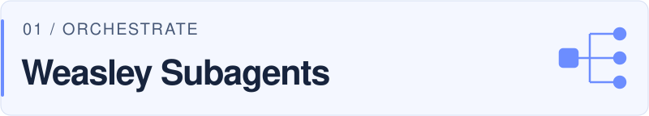
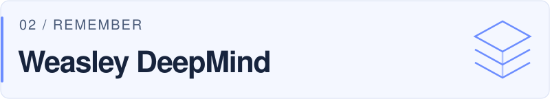

<picture>
  <source media="(prefers-color-scheme: dark) and (max-width: 600px)" srcset="./assets/profile-header-mobile-dark.svg" />
  <source media="(max-width: 600px)" srcset="./assets/profile-header-mobile.svg" />
  <source media="(prefers-color-scheme: dark)" srcset="./assets/profile-header-dark.svg" />
  
</picture>

  <a href="#selected-work">Selected work</a> &nbsp; / &nbsp;
  <a href="#beyond-the-agent-loop">Beyond the agent loop</a> &nbsp; / &nbsp;
  <a href="https://github.com/potatohoney-p?tab=repositories">All repositories</a>

I build the machinery around AI agents: **orchestration, persistent memory, and evaluation**. My public projects explore how to make the path from a prompt to a result visible, inspectable, and easier to build on.

## Selected work

Three parts of the same question: **how do we make agent work easier to inspect?**

<a href="https://github.com/potatohoney-p/weasley-subagents">
  <picture>
    <source media="(prefers-color-scheme: dark)" srcset="./assets/project-subagents-dark.svg" />
    
  </picture>
</a>

**[Weasley Subagents ↗](https://github.com/potatohoney-p/weasley-subagents)** — Coordinate focused agents without losing the parent session. A Pi extension with parallel reviews, explicit handoffs, background runs, and bounded execution. TypeScript · Pi · Worktree isolation

<a href="https://github.com/potatohoney-p/weasley-deepmind">
  <picture>
    <source media="(prefers-color-scheme: dark)" srcset="./assets/project-deepmind-dark.svg" />
    
  </picture>
</a>

**[Weasley DeepMind ↗](https://github.com/potatohoney-p/weasley-deepmind)** — Give agents memory with structure. A self-hosted MCP server for typed fragments, linked evidence, and retrieval within a token budget. JavaScript · PostgreSQL / pgvector · MCP

<a href="https://github.com/potatohoney-p/weasley-autoresearch">
  <picture>
    <source media="(prefers-color-scheme: dark)" srcset="./assets/project-autoresearch-dark.svg" />
    
  </picture>
</a>

**[Weasley AutoResearch ↗](https://github.com/potatohoney-p/weasley-autoresearch)** — Make experimentation leave evidence. A guarded Pi loop that runs benchmarks, records results, keeps improvements, and reverts regressions. TypeScript · Pi · Benchmark harnesses

## Beyond the agent loop

- **[Weasley Assistant](https://github.com/potatohoney-p/weasley-assistant)** — A local-first Python runtime with explicit tool calls, layered memory, traces, and deterministic evaluation.
- **[Weasley Podex](https://github.com/potatohoney-p/weasley-podex)** — A multi-agent workspace and orchestration toolkit with a browser dashboard.
- **[potato box](https://github.com/potatohoney-p/potato_wiki_box)** — Source material into a linked Markdown knowledge base, with provenance and review queues.
- **[Potaty](https://github.com/potatohoney-p/potaty)** — Editable ASCII diagrams grounded in prompts, transcripts, and repository evidence.
- **[Weasley Frame](https://github.com/potatohoney-p/weasley-frame)** — Live-web research into sourced datasets you can inspect, refresh, and export.

## Questions behind the code

**Control** — How can agents delegate work while keeping scope, state, and handoffs explicit?

**Continuity** — What should an agent remember, and what evidence should travel with it?

**Feedback** — How can we measure an improvement and retain the record of what changed?

---

<picture>
  <source media="(prefers-color-scheme: dark)" srcset="https://raw.githubusercontent.com/potatohoney-p/potatohoney-p/output/github-snake-dark.svg" />
  <source media="(prefers-color-scheme: light)" srcset="https://raw.githubusercontent.com/potatohoney-p/potatohoney-p/output/github-snake.svg" />
  
</picture>

Open the repositories. Follow the evidence. Build on what is there.

