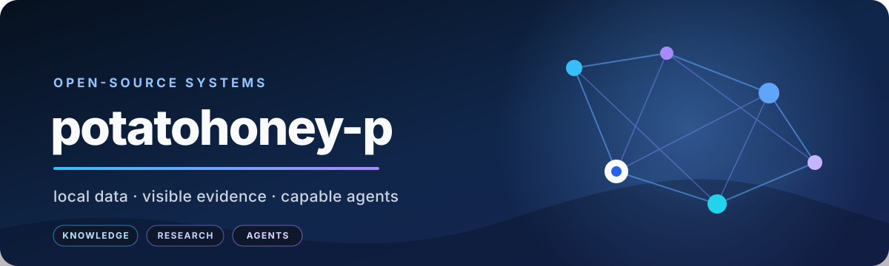

  

  <strong>Building open-source AI systems you can inspect, run, and keep.</strong>

  Local-first AI&nbsp;&nbsp;·&nbsp;&nbsp;Source-grounded tools&nbsp;&nbsp;·&nbsp;&nbsp;Agent orchestration&nbsp;&nbsp;·&nbsp;&nbsp;Durable knowledge

  
  

## What I build

I work on AI tools where the important parts stay visible: sources, state, memory, evaluation, and the path from input to output. My public projects span local-first knowledge workspaces, evidence-linked diagrams, live-web research, agent memory, and guarded multi-agent workflows.

- **Inspectable by default** — durable files, explicit provenance, reviewable outputs, and deterministic checks.
- **Local-first where it matters** — user-controlled workspaces, self-hosted paths, and clear provider boundaries.
- **Agents with guardrails** — bounded delegation, measurable experiments, auditable state, and safe failure modes.

## Featured work

| Project | What it makes possible | Built with |
| --- | --- | --- |
| [**potato box**](https://github.com/potatohoney-p/potato_wiki_box) | Turns documents and web material into a linked Markdown knowledge base with provenance, review queues, search, graphs, and health checks. | TypeScript · React · Rust · Tauri |
| [**Potaty**](https://github.com/potatohoney-p/potaty) | Produces editable, source-grounded ASCII diagrams from prompts, transcripts, and GitHub repositories while retaining evidence and warnings. | Kotlin/JS · Kotlin/JVM · Ktor |
| [**Weasley Assistant**](https://github.com/potatohoney-p/weasley-assistant) | A transparent, local-first assistant with tools, layered memory, multiple gateways, MCP connectors, traces, and deterministic evaluation. | Python · SQLite · MCP |
| [**Weasley Frame**](https://github.com/potatohoney-p/weasley-frame) | Turns plain-language research questions into sourced, inspectable, refreshable datasets that can be exported as CSV or XLSX. | TypeScript · Next.js · Fastify · Mastra |
| [**Weasley DeepMind**](https://github.com/potatohoney-p/weasley-deepmind) | Stores typed memory fragments and recalls relevant context for agents through local or HTTP MCP transports. | JavaScript · PostgreSQL · pgvector · Redis |
| [**Weasley Podex**](https://github.com/potatohoney-p/weasley-podex) | An open-source multi-agent workspace and orchestration toolkit with a browser dashboard. | TypeScript · MCP |

## Weasley open-source ecosystem

| Component | Role |
| --- | --- |
| [weasley-subagents](https://github.com/potatohoney-p/weasley-subagents) | Focused Pi subagents, parallel reviews, saved workflows, background runs, and bounded execution. |
| [weasley-autoresearch](https://github.com/potatohoney-p/weasley-autoresearch) | Guarded autonomous experiment loops that measure changes, keep improvements, and revert regressions. |
| [weasley-deepmind](https://github.com/potatohoney-p/weasley-deepmind) | Secure, fragment-based long-term memory for MCP-compatible agents. |
| [weasley-frame](https://github.com/potatohoney-p/weasley-frame) | Live-web research coordinated into verifiable, refreshable datasets. |
| [weasley-assistant](https://github.com/potatohoney-p/weasley-assistant) | A readable assistant runtime with tools, memory, gateways, and evaluation. |

## Technologies in the workbench

  
  
  
  
  
  
  
  
  
  

## GitHub at a glance

  

  
  

Public project descriptions and technology labels are grounded in the linked repositories and their README files.

